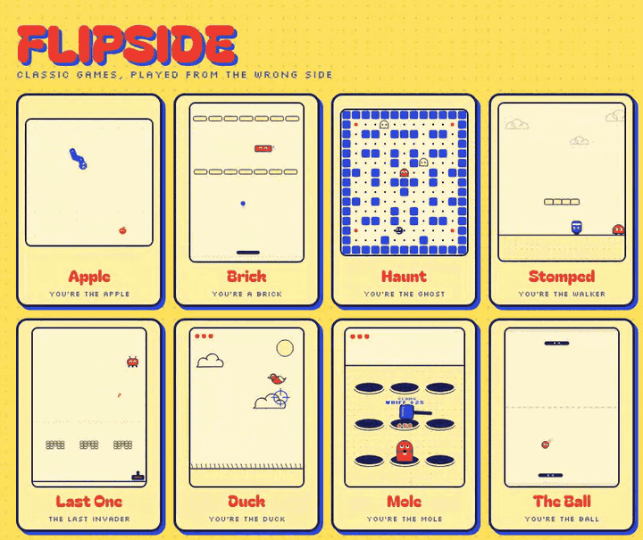
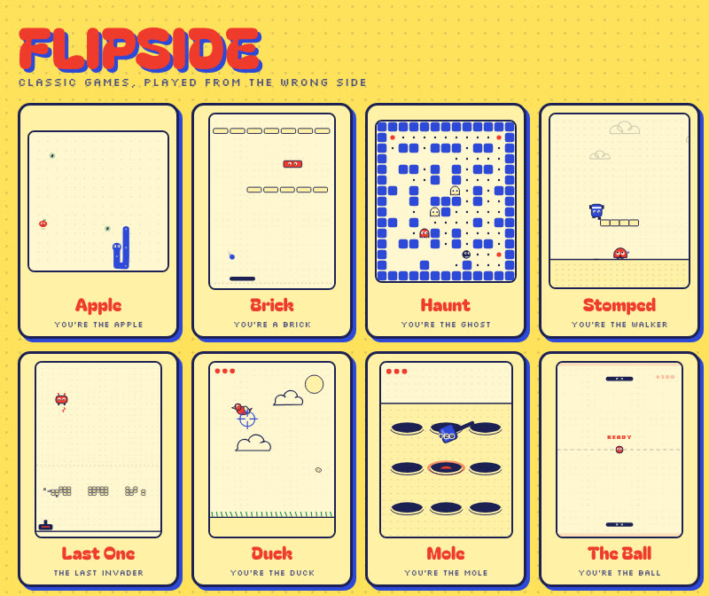
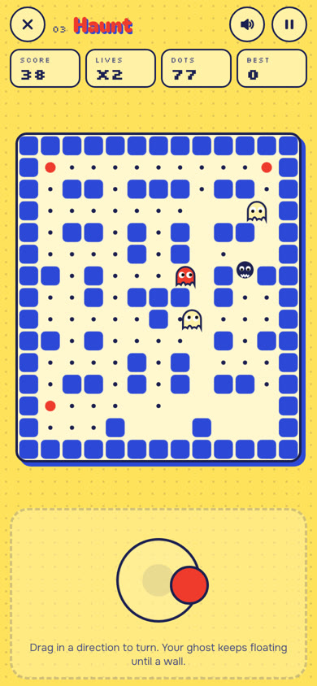

<div align="center">

<a href="https://jorgesousa.github.io/flipside/"></a>

# FLIPSIDE

*Classic games, played from the wrong side.*

**Every arcade hero needs something to chase, eat or smash. Flipside hands you the controller for that thing.**

[](https://jorgesousa.github.io/flipside/)

[](#play-anywhere)
[](js)
[](#test)
[](LICENSE)

</div>

---

You know the snake game. You've eaten a thousand apples. This time you're the apple.

Flipside is a set of tiny arcade games where the rules stay exactly the same and only the side changes. The famous hero becomes the computer, plays to win, and doesn't feel sorry for you. You play the thing that was built to be eaten, smashed or shot, and you find new ways to win: survive longer, steal the bonus, or make the hero fail at its own game.

<div align="center">
<a href="docs/media/trailer.mp4"></a>
<br><sub>▶ <a href="docs/media/trailer.mp4">Watch the 12-second clip</a>. Every frame is the real games, played by simple bots.</sub>
</div>

## The eight flips

| # | Game | Flip of | You are… | You score by… |
|:-:|---|---|---|---|
| 01 | **Apple** | the snake game | the apple | surviving, grabbing seeds, and tricking the snake into biting itself |
| 02 | **Brick** | the brick-breaker | one brick in the wall | dodging the ball, close calls, and making the paddle miss |
| 03 | **Haunt** | the maze chase | the red ghost | catching the muncher before it clears the maze, with two buddy ghosts |
| 04 | **Stomped** | the platformer | the little walker | dodging the stomp (watch its shadow) and bumping the hero from the side |
| 05 | **Last One** | the alien shooter | the last invader | surviving the cannon and bombing it back |
| 06 | **Duck** | the duck-shooting game | the duck | swerving when the crosshair turns red, hiding in clouds, grabbing crumbs |
| 07 | **Mole** | whack-a-mole | the mole | staying above ground, eating carrots, and making the hammer whiff |
| 08 | **The Ball** | the paddle game | the ball | curving past either paddle, as often as you can in 45 seconds |

Twenty more flips are waiting on the page, from the frog-crossing game (you drive the traffic) to mini golf (you're the hole).

## Play anywhere



Open the link and play, nothing to install. Each game opens full screen, and the screen stays on while you play.

On a phone, **hold anywhere and drag**: a joystick appears under your thumb, and letting go stops you. Stomped adds a big **Hop** button, and in Mole you just hold the hole you want to pop out of. Every game buzzes when something happens (where the phone supports it).

| | Phone | Keyboard |
|---|---|---|
| Move | Hold and drag anywhere | ← ↑ → ↓ or W A S D |
| Hop (Stomped) | Hop button, or flick up | ↑ or W |
| Pop up (Mole) | Hold a hole | Q W E / A S D / Z X C, or 1–9 |
| Pause | ‖ | Space or P |
| Back to all games | ✕ | Esc |

Your best score for each game is kept on your device. Every game has its own link too, like [`#play-haunt`](https://jorgesousa.github.io/flipside/#play-haunt).

<br clear="right">

## What's in it

- **Same rules, other side.** No new controls to learn. The board, the walls and the speed-up are the ones you already know.
- **The hero plays to win.** The snake chases by shortest path, the paddle aims the ball at you, the hero leads its jumps, the cannon leads its shots. Each one has a weakness, and finding it is the game.
- **Telegraphs you can read.** A red glow where the hammer will land, a crosshair that shrinks before it fires, a shadow under the jumping hero.
- **Built for one thumb.** A floating joystick, big buttons, vibration, no page scrolling while you play.
- **Tiny.** Plain HTML, CSS and canvas, one small JavaScript file per game, sounds synthesised with the Web Audio API. The only thing it loads is three fonts.
- **Original characters.** Every game is an homage to a classic genre, with its own names, art and code.

## Add your own flip

Each game is one file in [`js/`](js) that registers itself with the shell. The shell gives every game the same full-screen player, joystick, keyboard, HUD, sound, particles and best scores, so a game only needs `update`, `draw`, `score` and `hud`:

```js
FLIP.register({
  id: 'apple', num: '01', name: 'Apple', flipOf: 'the snake game',
  W: 300, H: 300,              // logical size; the shell scales it to the screen
  controls: 'joy4',            // joy4 · joyx · joyy · joy2d · tap
  role: "You're the apple.",
  intro: 'The snake is hungry and grows every few seconds…',
  hint: 'Hold anywhere and drag to roll. Let go to stop.',
  keys: 'Arrows or WASD to roll · Space pauses',
  create: (api) => ({
    update(dt, input) { /* input.x, input.y, input.dir4, input.pressed, input.ptr */ },
    draw(ctx, now) { /* api.D has drawing helpers, api.C the colours */ },
    score() { return 0; },
    hud() { return [['Score', 0], ['Time', '0.0s']]; }
    // call api.end({ title, text, quip }) when the run is over
  })
});
```

Add a `<script src="js/yourgame.js">` to `index.html` and a card to the list, and it shows up with everything else.

## Run it

```bash
npm start          # http://127.0.0.1:8933
```

No install and no build. Any static file server works, or just open `index.html`.

## Test

```bash
npm test
```

[`tests/smoke.js`](tests/smoke.js) loads every game in Node with no browser, plays it with scripted input for up to five minutes of game time, and checks that it never throws and always reaches a game-over screen. It runs on every push before the site is deployed.

```
ok   01 Apple     ended at 5.1s ("Chomp.")
ok   02 Brick     ended at 10.4s ("Smashed.")
ok   03 Haunt     ended at 20.8s ("Eaten.")
…
ok   08 The Ball  ended at 45.0s ("Time!")
```

## Deploy

Every push to `main` tests the games and publishes the site to GitHub Pages ([`.github/workflows/deploy.yml`](.github/workflows/deploy.yml)). In the repo settings, **Pages → Source** must be **GitHub Actions**.

## Credits

- Made by **Jorge Sousa**, with Claude, as part of Tosco Labs.
- Every game is an independent homage to a classic arcade or mobile genre. Names, characters, art, sound and code are original, and Flipside is not affiliated with or endorsed by the makers of any of the games it flips.
- Fonts: [Bagel Fat One](https://fonts.google.com/specimen/Bagel+Fat+One), [Onest](https://fonts.google.com/specimen/Onest) and [Silkscreen](https://fonts.google.com/specimen/Silkscreen), all under the SIL Open Font License, loaded from Google Fonts.
- Code under the [MIT License](LICENSE).
